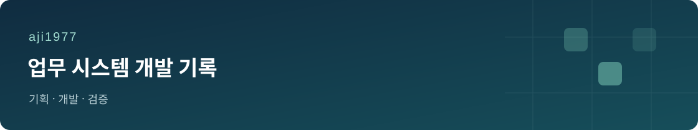

업무 흐름을 정리하고, 반복 작업을 줄이는 웹 도구를 만들고 개선합니다.

### 진행 중인 프로젝트

| 프로젝트 | 소개 | 진행 |
|---|---|---|
| 인사 업무 관리 | 인사 기록과 평가 업무를 한곳에서 관리하는 웹 서비스 | 기능 개선 |
| 근무 일정 관리 | 근무표 조회, 일정 변경 신청·승인, 근태 집계를 연결하는 시스템 | 개발·검증 |
| 이메일 보관·검색 | 보관된 이메일과 첨부 자료를 찾아보는 업무 도구 | 기능 개선 |

### 다음으로 준비하는 작업

- 홈페이지 리뉴얼 기획
- 업무 자료 검색과 챗봇 활용 검토

### 작업 방식

업무 요구사항을 정리한 뒤 화면과 데이터 구조를 설계합니다. 작은 단위로 구현하고, 테스트와 실제 화면 확인으로 점검합니다.

**사용 기술** · JavaScript / Node.js / PostgreSQL / HTML / CSS
